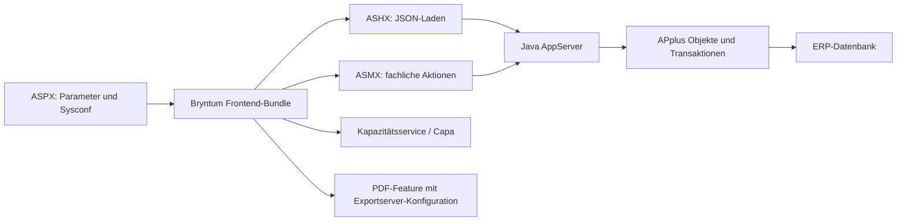
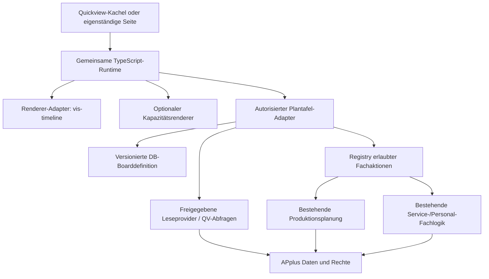

# APplus-Plantafeln mit Open Source: Analyse und Umsetzungsanweisung

Stand: 12.11.2026. Untersucht wurden der lokale Deploy-Quellstand, die ausgelieferten Frontend-Bundles, die Quickview-Implementierung und offizielle Framework-Dokumentationen.

## 1. Entscheidung in Kurzform

**Empfehlung: `vis-timeline` als austauschbarer Timeline-Renderer, TypeScript als gemeinsame Runtime, deklarative und versionierte JSON-Definitionen in der Datenbank. Die vorhandene APplus-Fachlogik bleibt zunächst hinter einem kontrollierten Adapter erhalten.**

Beide vorhandenen Plantafeln sind hauptsächlich **Ressourcen-Zeitleisten**, keine klassischen Projekt-Gantt-Diagramme: links Maschinen/Teams/Personen, rechts mehrere Belegungen je Ressource. Deshalb ist eine Resource-Timeline wichtiger als eine Bibliothek, die vor allem Aufgaben und Abhängigkeitspfeile zeichnet.

Der Vorschlag erfüllt „keine eigene Quellcodedatei je Plantafel“, nicht „überhaupt keine ausgelieferten Dateien“:

- Einmalig ausgelieferter, lesbar versionierter Runtime-Code und Bibliotheksdateien bleiben notwendig.
- Neue Plantafeln, Filter, Beschriftungen, Farbregeln, Menüs, Feldzuordnungen und freigegebene Aktionen werden anschließend in der DB konfiguriert.
- Neue fachliche Operationen benötigen weiterhin getesteten Servercode. JavaScript oder SQL in der DB wird nicht automatisch zu einer sicheren Low-Code-Plattform.
- Eine Änderung des Renderers ersetzt **nicht** die ERP-Terminierungs- und Transaktionslogik.

**Keine der geprüften freien Bibliotheken ersetzt den gesamten Bryntum-/APplus-Stack ohne Eigenentwicklung.** Besonders Kapazitätsdiagramm, APplus-Dialoge, Schreibaktionen, Mehrbenutzerkonflikte und vollständiger Druck müssen integriert oder entwickelt werden.

### Empfohlener Umfang der ersten Umsetzung

1. Service-/Personalplantafel zunächst lesend, mit Teamstruktur, Mehrfachfiltern, Statusfarben, Tooltip und Absprüngen.
2. Service-Schreiboperationen über bestehende Fachservices kontrolliert freischalten.
3. Produktionsplantafel mit bestehender APplus-Terminierung anbinden.
4. Kapazitätsdiagramm, Druck und vollständige Funktionsparität nachziehen.

Ein Performance-/Bedienbarkeits-Prototyp ist ein **Entscheidungstor**, keine Formalität. Wenn `vis-timeline` bei realer Datenmenge oder notwendigem Tabellenlayout nicht ausreicht, wird nur der Renderer gewechselt; DB-Modell und Fachadapter bleiben.

## 2. Aussagekraft der Analyse

Die folgenden Begriffe sind verbindlich:

- **Belegt:** im lokalen Code, in Methodenaufrufen oder in den Bundles nachgewiesen.
- **Entwurf:** vorgeschlagene neue Architektur, noch nicht implementiert.
- **Offen:** benötigt Laufzeitprüfung, Datenbeispiele oder fachliche Entscheidung.

Es wurden keine Produktivdaten verändert, keine Plantafel gestartet und keine fachlichen Schreiboperationen ausgeführt. Es handelt sich um eine statische Analyse, keinen erfolgreichen End-to-End-Test.

Die Scheduler-Bundles sind teilweise nicht nur minifiziert, sondern über Stringtabellen verschleiert. Trotzdem sind Funktionsnamen, zahlreiche Navigationen, Feature-Konfigurationen und Serviceaufrufe belegbar. „Minifiziert“ ist kein Beweis, dass eine Funktion fehlt. Nicht alle Voraussetzungen und Verzweigungen konnten vollständig rekonstruiert werden.

Wichtige Präzisierung zur bisherigen Recherche: Histogramm/Kapazitätsdarstellung, PDF-Feature, Cookies und Detailnavigation sind in den Bundles vorhanden. Das Java-Custom-Backend der Personalplantafel ist **aktive Fachlogik**, nicht lediglich historischer Legacy-Code.

## 3. Framework-Auswahl und Lizenzgrenzen

Bewertet wird der Einsatz in einer bestehenden, nicht vollständig offengelegten APplus-Anwendung. „Kostenlos“, „auf GitHub“ und „Open Source“ sind nicht gleichbedeutend. Lizenzbedingungen der konkret gewählten Version und ihrer Abhängigkeiten vor Freigabe prüfen; dies ist keine Rechtsberatung.

| Kandidat | Lizenz/Edition laut geprüfter Quelle | Passung | Wesentliche Grenze | Entscheidung |
|---|---|---|---|---|
| **vis-timeline** | Wahlweise Apache-2.0 oder MIT | Gruppen, verschachtelte Gruppen, mehrere Zeitintervalle je Ressource, Zoom, Verschieben, Resize, editierbare Einträge, Templates | Kein fertiger ERP-Planungsalgorithmus, kein komplettes TreeGrid, kein Kapazitätshistogramm und kein vollständiger Plan-Druck | **Erste Wahl für DB-konfigurierbare gemeinsame Runtime** |
| **DayPilot Lite JavaScript** | Apache-2.0 | Inzwischen echte horizontale Ressourcen-Timeline, DnD, Resize, Kontextmenü, progressive Darstellung; ohne React nutzbar | Laut Lite/Pro-Matrix kein Ressourcenbaum, keine Row-Header-Spalten, kein integrierter Export/Druck, keine Mehrfachauswahl/-verschiebung und keine Dependency-Links | Gute Alternative für flache Maschinen-/Ressourcenlisten; für Servicebaum zusätzliche Eigenentwicklung |
| **react-calendar-timeline** | MIT | Ressourcenzeilen, Move/Resize, kontrollierte Zeitfenster und individuelle Renderer | Zusätzlicher React-Stack; Teambaum/Kapazitätsansicht selbst bauen; stabile und Beta-API unterscheiden | Alternative, wenn React strategisch feststeht |
| **Frappe Gantt** | MIT | Aufgaben, Fortschritt, Abhängigkeiten, einfache Projektvisualisierung | Aufgabenorientiert statt Ressourcenbelegung mit vielen Einsätzen pro Person | Nicht als gemeinsame Basis für diese beiden Plantafeln |
| **SVAR Gantt Open Source** | MIT für die offene Edition | Aufgabenbaum, Grid, DnD, Abhängigkeiten | Ressourcenplanung, Ressourcenlast/Histogramm und zahlreiche Kalender-/Planungsfunktionen in PRO | Eher Projekt-Gantt, nicht die bevorzugte Ressourcenplantafel |
| **DHTMLX Gantt Community** | Aktuelle Dokumentation: ab v10 MIT; freie v9 und älter GPLv2 | Aufgaben-Gantt mit Grid und Links | Ressourcenmanagement und zahlreiche Scheduling-Funktionen in PRO; Lizenz ist versionsabhängig | Keine naheliegende freie Komplettlösung für diesen Zweck |
| **FullCalendar Standard / Premium** | Standard MIT; Ressourcen-Timeline Premium mit separaten Bedingungen | Gute Kalender-/Ressourcenbedienung mit Premium | Standard enthält gerade die benötigte Ressourcen-Timeline nicht; offene Premium-Nutzung hat Copyleft-Anforderungen | Nicht als freier, permissiver Ersatz empfehlen |
| **gantt-schedule-timeline-calendar (GSTC)** | Aktuell NEURONET Free/Trial bzw. kommerzielle Bedingungen | Technisch sehr nahe am Anwendungsfall | GitHub-Verfügbarkeit ist keine permissive Open-Source-Lizenz | Unter der strengen Open-Source-Vorgabe ausscheiden |

### Warum `vis-timeline` hier vorne liegt

1. Keine neue React-/Angular-/Svelte-Anwendungsarchitektur nötig: passt als TypeScript-Modul in die bestehende WebForms-Umgebung.
2. `groups`, `nestedGroups` und `showNested` bilden Team-/Ressourcenstruktur ab.
3. Einträge unterstützen `start`, `end`, `group`, `subgroup`, `className`, `editable` und Hintergrundintervalle.
4. `onMove`, `onAdd`, `onUpdate` und `onRemove` erlauben kontrollierte Annahme/Ablehnung. `callback(null)` verwirft eine Änderung.
5. Regeln und Darstellung können über eine eigene, sichere Übersetzungsschicht aus DB-JSON entstehen.
6. Keine Lizenzpflicht pro Planer aus den genannten MIT-/Apache-Lizenzen; Lizenztexte/Notices trotzdem mitliefern.

### Grenzen der Empfehlung

- Keine pauschale Zusage für zehntausende gleichzeitig sichtbare Objekte. DOM-Rendering, Gruppenanzahl, Stacking und Templates beeinflussen die Laufzeit erheblich.
- Verschachtelte Gruppen sind kein vollwertiger mehrspaltiger TreeGrid. Wenn viele unabhängig sortier-/skalierbare Spalten fachlich erforderlich sind, muss das im Prototyp geprüft werden.
- Keine Zusage für vollständige Zeilenvirtualisierung oder synchrones TreeGrid-Verhalten. Zeitfenster-/Ressourcenbegrenzung und Ladeadapter sind trotzdem notwendig.
- `hiddenDates` komprimiert die Zeitachse; das ist nicht dasselbe wie ressourcenspezifische Arbeitskalender oder ERP-Arbeitszeitberechnung.
- Stacking zeigt Überschneidungen an; es berechnet weder zulässige Kapazität noch eine optimale Planung.
- Große eigene Sortier-/Templatefunktionen vermeiden; die vis-Dokumentation warnt insbesondere vor aufwendiger benutzerdefinierter Item-Sortierung.
- Kapazitätsdiagramme beispielsweise mit Chart.js (MIT) ergänzen. Gemeinsamen Zeitraum synchronisieren; eine pixelgenaue Achsensynchronisierung entsteht nicht automatisch.
- Wenn neue Anforderungen echtes APS/Optimierung verlangen, ist das ein separates Backendprojekt. Nicht stillschweigend mit der UI-Migration vermischen.

## 4. Heutige Gesamtarchitektur



Es gibt zwei unterschiedliche Kommunikationsarten:

1. **Laden:** Bryntum-artiger `load`-Request mit Stores und JSON-Antwort.
2. **Ändern:** fachliche ASMX-Aufrufe, die Java-Methoden, Objektlogik und Transaktionen auslösen. Ein sichtbarer `sync`-Zweig ist kein Beweis für universelles CRUD.

Diese Trennung muss beim Nachbau erhalten bleiben. Ein generisches SQL-UPDATE auf Start/Ende genügt nicht.

## 5. Ist-Funktionsweise: Produktion

### 5.1 Einstieg und Quellen

- [Plantafelseite](WebProject/WebServer/Wp/WpScheduler.aspx): URL-Parameter, CSS, Bibliotheken, Kontextwerte.
- [TypeScript-Initialisierung](WebProject/WebServer/Wp/Scripts/WpScheduler.ts): App-Ready, Kontextvariablen, Markierungs-/Fertigstellungsfarben, Aufruf `pageLoad()`.
- [Ausgeliefertes Frontend-Bundle](WebProject/WebServer/Wp/appWpScheduler.min.js): eigentliche UI, Menüs, Interaktionen und Kapazitätsansicht.
- [JSON-Handler](WebProject/WebServer/Wp/WpScheduler.ashx.cs): Aufruf `p2wp/WAuftragPlan.CRUDRequest`.
- [Fachliche WebMethods](WebProject/WebServer/Wp/WauftragPlan.asmx.cs).
- [Java-Service](AppServer/P2Java/com/apag/p2plus/p2wp/WAuftragPlan.java).
- [Planungs- und Datenlogik](AppServer/P2Java/com/apag/p2plus/p2wp/WAuftragPlanUtil.java).

Die kurze TypeScript-Datei ist **nicht** der vollständige lesbare Ursprung des Bundles. Für die Neuimplementierung eine eigene nachvollziehbare Runtime bauen, nicht das verschleierte Bundle als neue Grundlage pflegen.

### 5.2 Ressourcen und Arbeitsgänge

Belegt in [Ressourcenaufbereitung](AppServer/P2Java/com/apag/p2plus/p2wp/WAuftragPlanUtil.java#L475-L558):

- Ressourcen basieren auf Kostenstellen/-trägern und Maschinengruppen (`KOST`, `MAGR`).
- Ressourcenattribute: `id`, `kost`, `kostname`, `magr`, `magrname`; `itemsort` wird zur technischen `id`.
- Die Datenquelle liefert einen Ressourcenindex, keinen Service-Teambaum. Hierarchie/Spaltenanzeige der neuen Oberfläche getrennt definieren.
- Planbare Maschinengruppen und die Option „nur belegte Gruppen“ beachten.

Arbeitsgänge werden aus terminierten/in Arbeit befindlichen Positionen geladen. Start, Vorlaufende, Nachlaufstart, Ende und Ressourcenzuordnung sind relevante Voraussetzungen. Simulationen werden optional einbezogen.

Belegte Felder und Mapping aus [Event-Erzeugung](AppServer/P2Java/com/apag/p2plus/p2wp/WAuftragPlanUtil.java#L314-L416):

| Fach-/Alt-Feld | Bedeutung bzw. Ausgabe |
|---|---|
| `start` | wird `startDate` |
| `ende` | wird `endDate` |
| `magr` | wird `resourceId` |
| `color` | wird `eventColor` |
| `ende_vlz`, `start_nlz` | Phasengrenzen; nicht mit normalem Start/Ende zusammenwerfen |
| `bauftrag`, `position`, `ag` | fachlicher Arbeitsgangschlüssel |
| `ag_key`, `ag_display`, `wauftrag` | Zusatz-/Anzeige- und Auftragsbezug |
| `fertig`, `fixieren` | Fertigstellung/Fixierung |
| `id`, `userID` | technische Identifikation im bestehenden Vertrag |

**Nicht blind `magr` allein als neue globale Ressourcen-ID verwenden.** Alle Alt-IDs und fachlichen Schlüssel in Beispieldaten gegenprüfen; insbesondere gleiche Maschinengruppen in unterschiedlichen Kostenbereichen und historische ID-Kollisionen berücksichtigen.

### 5.3 Ladevertrag

Belegt in [CRUDRequest](AppServer/P2Java/com/apag/p2plus/p2wp/WAuftragPlan.java#L36-L159):

- Handler liest `data` und `para`; `op` kommt aus dem Pfad.
- Das JSON in `data` enthält unter anderem `type`, `requestId`, `stores`.
- Bei `type=load` werden `resources`, `events`, `timeRanges` verarbeitet.
- Antwort enthält `success`, `requestId`, `revision` sowie Store-Objekte mit `rows` und `total`.
- `timeRanges` wird in diesem Pfad leer geliefert.
- `para` transportiert den Planungsbereich und Filter; Backendnamen umfassen `start`, `ende`, `bauftrag`, `projekt`, `wauftrag`, `showSim`, `showUsed`, `calcDate`.
- URL-Namen wie `end`, `showsim`, `showused` und Backendnamen nicht ungeprüft gleichsetzen; Adapter muss normalisieren.

### 5.4 Fachliches Verschieben und Terminieren

Zentrale Operation aus [Java-Service](AppServer/P2Java/com/apag/p2plus/p2wp/WAuftragPlan.java#L251-L293) und [Implementierung](AppServer/P2Java/com/apag/p2plus/p2wp/WAuftragPlanUtil.java#L634-L853):

`scheduleProductionOrder(bauftrag, position, ag, start, ende, ctrlPressed, fixStart, fixEnd, kost, magr, filter, ignoreAlternMagr)`

Wesentliche Semantik:

1. Arbeitsgang und gewünschte Zielressource ermitteln.
2. Start-/Endfixierung und direkte Verschiebungsvariante abhängig von Flags behandeln.
3. Alternative Kosten-/Maschinengruppe berücksichtigen.
4. Im regulären Planungsfall `WAuftragUtil.scheduleProductionOrder2(...)` ausführen.
5. Optional über `ScheduleUtil.scheduleCentralBOM(...)` weiter disponieren.
6. Geänderte Arbeitsgänge zurückgeben; Überlast kann eine `jobID` für die Überlastliste erzeugen.

Das bedeutet: **Eine Benutzeraktion kann mehrere Arbeitsgänge ändern.** Der neue Client muss alle betroffenen Events aktualisieren, nicht nur den gezogenen Balken. Die UI darf keine eigene Scheduling-Logik an die Stelle des Servers setzen.

Das Fehlen eines eigenen Dependency-Stores im Ladevertrag bedeutet **nicht**, dass Arbeitsgänge fachlich unabhängig sind. Reihenfolgen und Folgewirkungen werden in der APplus-Terminierung behandelt. Ein frei editierbarer Abhängigkeitspfeil ist dagegen im untersuchten Ladevertrag nicht belegt.

### 5.5 Bedienung, Kapazität und Darstellung

In Seite, Bundle und WebMethods belegt:

- Zeitfenster, Zeitskalen/Zoom, Heute-Navigation und Neuladen.
- Filter-/Selektionsfunktionen, Auswahl eines Betriebsauftrags und Markieren zusammengehöriger Daten.
- Ressourcenauswahl und alternative Maschinenwahl; Bundle nennt `MGSelectDlg.aspx` und eine Überlastliste mit `jobID`.
- `processContextMenuItems`, `selectBauftrag`, `updateEvents`, `preprocessData`, `buildLoadPara`.
- `setCurrentResource`, `showHistogram`, `redrawHistogram`, `bottomScheduler` und Aufruf `GetBelegung(...)`.
- Belegungsdaten kommen über [GetBelegung](WebProject/WebServer/Wp/WauftragPlan.asmx.cs#L174-L198) aus `capacityPlanningMagr(...)`; Ressourcenschlüssel dort `KOST%MAGR`.
- Tooltip über `getToolTipText`, Schlüssel `BAUFTRAG|POSITION|AG`, mit Auftrag, Arbeitsgang, Status, Zeiten, Dauer, Fertigstellung, Artikel und Mengen.
- Filter-, Zeitskalen- und Layoutpersistenz über Cookie-Hilfsfunktionen; beispielsweise `getCookieNameLayout()` mit `WpSchedulerLayout`.
- `pdfExport` mit `exportServer`, Header-/Footer-Templates und Credential-Konfiguration ist im Bundle vorhanden. Die Erreichbarkeit des konfigurierten Dienstes wurde nicht getestet.

### 5.6 Relevante Konfiguration und Rechte

Die [Seitenkonfiguration](WebProject/WebServer/Wp/WpScheduler.aspx#L104-L121) und [Sysconf](AppServer/Config/sysconf.xml#L1930-L1958) nennen unter anderem:

- `JGANTT_TIMEOUT`, `JGANTT_PAST_MONTHS`, `JGANTT_FUTURE_MONTHS`, `JGANTT_TIMESCALE_TYPE`.
- `PLANTAFEL_USETIMEPERIODFROMCOOKIE`, `PLANTAFEL_MOVEDAYWISE`, `SHOWUSEDONLY`.
- `JGANTT_AUTOSHOW_OVERLOADLIST`, `JGANTT_DISPATCH_SATISFIER`, `FORCEALTERNATIVE`.
- `COLORAG2`, `COLORAG3OK`, `COLORAG3NOTOK`, `COLORCOMPLETED`, `COLORSIMAG`, `MARKCOLOR`.
- `DESCINBAR`, `DESCOVERFLOW`, `NUMSCALETEXTVISIBLE`, Exportserver-Konfiguration.

Rechte für Laden, Tooltip, alternative Maschinen, Belegung und Terminierung sind in [WebRights](AppServer/Config/WebRights.config#L22872-L22902) registriert. Diese Registrierung allein beweist nicht die vollständige Autorisierung einer neu vorgeschalteten API. Jeden neuen Lese- und Schreibpfad separat absichern.

Änderungsbeleg aus dem vorhandenen SVN-Export: Ticket 144698, „Fehler in der Fertigungsplantafel (AV)“, r786 vom 07.04.2026, Übernahme aus Deploy r635 / RSC r1713; betroffen waren Seite, TypeScript und Bundle. Der Logeintrag ist ein Änderungsbeleg, keine vollständige Spezifikation des damaligen Fehlers.

## 6. Ist-Funktionsweise: Service und Personal

### 6.1 Standard und Custom unterscheiden

- [Gemeinsame Ressourcenplantafel](WebProject/WebServer/Resource/ResourceScheduler.aspx).
- [Kurze TypeScript-Initialisierung](WebProject/WebServer/Resource/Scripts/ResourceScheduler.ts).
- [Frontend-Bundle mit Standard- und Custom-Funktionen](WebProject/WebServer/Resource/appResourceScheduler.min.js).
- [Ladehandler mit Umschaltung](WebProject/WebServer/Resource/ResourceScheduler.ashx.cs#L41-L59).
- [Standard-Java-Service](AppServer/P2Java/com/apag/p2plus/p2resource/RessourcePlan.java) und [Standard-Utilities](AppServer/P2Java/com/apag/p2plus/p2resource/RessourcePlanUtil.java).
- [Personal-Filtermaske](WebProject/WebServer/Custom/Anp_PTPersonal.aspx) und [Filter-/Startlogik](WebProject/WebServer/Custom/Scripts/Anp_PTPersonal.ts).
- [Custom-WebMethods](WebProject/WebServer/Custom/Anp_RessourcePlan.asmx.cs).
- [Custom-Java-Service](AppServer/P2Java/com/apag/p2plus/p2custom/Anp_RessourcePlan.java) und [Custom-Fachlogik](AppServer/P2Java/com/apag/p2plus/p2custom/Anp_RessourcePlanUtil.java).

Die Custom-Maske öffnet die gemeinsame Seite mit `FULLPT=1`. Die Seite übergibt zusätzliche Parameter und ändert den Titel zu „Plantafel Personal“. Codeblöcke sind mit Ticket **142553**, RSC/RL, 28.11.2024 gekennzeichnet. Der vorhandene SVN-Export nennt dazu r184 vom 22.01.2025.

**Ist-Stolperfalle:** Der ASHX-Handler prüft die Existenz von `details["anp_fullpt"]`, nicht ausdrücklich dessen Wert `"1"`. Die neue API muss statt dieser Mehrdeutigkeit einen validierten Modus wie `service-standard` oder `service-personal` verwenden. Auswirkungen der derzeitigen Serialisierung auf den Standardpfad vor Migration mit echten Requests prüfen.

### 6.2 Ressourcenbaum

Belegt in [Custom-Baumaufbau](AppServer/P2Java/com/apag/p2plus/p2custom/Anp_RessourcePlanUtil.java#L233-L446):

- Team/Ressourcengruppe als übergeordneter Knoten.
- Ressourcen als Kinder mit Kennung, Name, Teambezug und GUID; unter anderem `id`, `RES`, `RNAME`, `TNAME`, `RESGUID`.
- Optionale Personalreferenz über Ressource/Referenzobjekt.
- Sortierung nach Team und Ressourcenname.
- Eigener „Nicht zugewiesen“-Bereich, wenn aktiviert.

Teamknoten sind **nicht automatisch zulässige Zielressourcen**. Die neue Runtime benötigt `isAssignable`/Ressourcentyp statt allein einer vorhandenen Gruppen-ID.

### 6.3 Fachobjekte und Ereignisse

Der Standardpfad verarbeitet Ressourcenbezüge zu Service-/Auftrags-/Angebots-/Projektpositionen und Blockern. Die Custom-Personalplantafel ergänzt bzw. verwendet insbesondere:

- `RSCServiceEinsatz`: Serviceeinsatzkopf.
- `RSCSEPERSONAL`: Personal-/Ressourcenzuordnungen mit eigenen Zeitbereichen.
- `RSCFehlzeit`: Fehlzeiten bzw. Reservierungen je nach Erzeugungsaktion.
- `REZU` und service-relevante `UGRUND`-Blocker für entsprechende Standard-/Custom-Aktionen.
- Projekt, Kostengruppe, Anlage, Kunde und Ressourcengruppe als fachlicher Kontext.

Die [Einsatzabfrage](AppServer/P2Java/com/apag/p2plus/p2custom/Anp_RessourcePlanUtil.java#L1089-L1185) vereinigt Einsatzköpfe und Personalzuordnungen per `UNION ALL`. Dabei werden unterschiedliche Kennungen erzeugt, z. B. `SE...` und `PE...`. **Ein Einsatzkopf ist nicht identisch mit einer Personalzuordnung; mehrere Balken können dasselbe fachliche Einsatzobjekt betreffen.**

Relevante Zusatzfelder aus [Event-Aufbereitung](AppServer/P2Java/com/apag/p2plus/p2custom/Anp_RessourcePlanUtil.java#L1796-L1944):

- `REFOBJEKT`, `OBJGUID`, `OBJEKT`, `POSGUID`, `RESGUID`.
- `ANP_SE_KENNER`, `ANP_SESTATUS`, `ANP_SEID`, `ANP_SE`, `ANP_SEPID`, `ANP_RGID`.
- `POSSTART`, `POSENDE`, `REZUSTART`, `REZUENDE`, `POSNAME`, `POSKGR`.
- `DONE`, `FIXIERT`, `CL`, `RNAME`, `TNAME`, `PERSONAL`.
- `PROJEKT`, `KOSTENGRUPPE`, `ANLAGE`, `ANLAGENAME`.
- `KDNAME`, `KDPLZ`, `KDORT`, `KMBEMERKUNG`.

Blocker-/Zuordnungsdaten können zusätzlich `REZUGUID`, `REZUFIXIERT`, `REZUGELESEN`, `REZUSTATUS`, `REISEDAUER` tragen. Nicht jedes Feld kommt bei jedem Typ vor. `null`, fehlender Wert und Leerstring müssen im Adapter ausdrücklich behandelt werden.

Die neue normalisierte Ereignis-ID muss eindeutig pro **Darstellungs-/Zuordnungsinstanz** sein; zusätzlich den Fachschlüssel erhalten. Nicht auf eine einzige numerische Serviceeinsatz-ID reduzieren.

### 6.4 Filter und ihre genaue Semantik

Die [Filterlogik](WebProject/WebServer/Custom/Scripts/Anp_PTPersonal.ts#L42-L145) unterstützt:

- Zeitraum Start/Ende; Initialbereich aus Sysconf-Monaten.
- Kostengruppe.
- Ressourcengruppen-Mehrfachauswahl.
- Ressourcen-Mehrfachauswahl, eingeschränkt durch die gewählten Gruppen.
- Projektfilter auf dem Backendpfad.
- Nicht zugewiesene Einträge.
- WV-Sonderfilter.
- Serviceeinsatzstatus zum **Ausblenden**.
- Spezialwert `[p2user]`: Seite ermittelt aus aktuellem Benutzer Personal/GUID und passende Ressource.

Backendparameter: `anp_kostengruppe`, `anp_ressourceGruppe`, `anp_ressource`, `anp_shownotassigned`, `anp_noWVStat`, `anp_filterStat`.

**Unbedingt erhalten bzw. bewusst umbenennen:** `_FILTERSTAT` ist eine **Ausschlussliste**, denn SQL verwendet `se.STATUS not in (...)`. Die anfänglich gesetzte Checkbox 9 blendet abgerechnete Einsätze aus.

| Status | Beschriftung der vorhandenen Maske |
|---|---|
| 1 | angelegt |
| 2 | bereit |
| 3 | freigegeben |
| 4 | AD übernommen |
| 5 | AD in Bearbeitung |
| 6 | AD Nacherfassung |
| 7 | AD beendet |
| 8 | geprüft |
| 9 | abgerechnet |

Der WV-Filter bedeutet konkret: `STATUS > STATUS_ANGELEGT` **oder** Auftragsart ungleich `WV`. Also WV-Einsätze im Status „angelegt“ ausschließen, **nicht sämtliche WV-Einsätze**.

Stornierte Einsätze werden in der untersuchten Einsatzabfrage zusätzlich ausgeschlossen. Die vorhandenen CSV-/SQL-Stringverkettungen nicht als neue Schnittstellenkonvention übernehmen: neue Filter sind typisierte Arrays mit gebundenen Parametern.

### 6.5 Laden und Eventmapping

Wie Produktion: `load` für `resources`, `events`, `timeRanges`, Antwort mit `rows`, `total`, `requestId`, `revision`, `success`.

Die Custom-Ereignisse werden über `getReZuDataAsJson(...)` und die Utilities erzeugt. Normalisierte Kernattribute für die Oberfläche sind `id`, `resourceId`, `startDate`, `endDate`, `name`, `eventColor`; die übrigen Fachfelder bleiben relevant für Aktionen, Tooltips und Filter.

`timeRanges` ist in den untersuchten Ladepfaden leer. Feiertage/Arbeitszeiten dürfen deshalb nicht als bereits vollständig geliefertes Kalender-Modell angenommen werden.

### 6.6 Aktionskatalog und vorhandene Backend-Anker

Die folgenden Namen sind belegte vorhandene WebMethods; ihre komplette Eingabevalidierung, Berechtigung und Rückgabe wird vor Freischaltung durch Adapter-Contracttests überprüft.

| Funktion | Vorhandener Anker | Nachbau-Regel |
|---|---|---|
| Verschieben, Resize, Ressourcenwechsel | `changePositionAsJson(reZuGuid, posObjekt, posGuid, resGuid, rgID, seID, sepID, startDate, endeDate)` | Typabhängig Zuordnung/Fehlzeit/Einsatz bearbeiten; Serverantwort übernehmen |
| Voraussetzungen prüfen | `checkRessourcenVoraussetzungen`, `checkInsertAuftragVoraussetzung`, `checkChangedStartEnde` | Nicht durch reine Clientprüfung ersetzen |
| Serviceauftrag/-einsatz anlegen | `createServiceOrderAsJson` | Bestehende Dialog-/Fachlogik anbinden |
| Reservierung anlegen | `createResAsJson` | Projekt/Auftrag/Kostengruppe/Gruppe/Ressource und Bemerkung berücksichtigen |
| Fehlzeit anlegen | `createFehlZtAsJson` | Schreibweise im C#-Webservice; Java-interne Namen können abweichen |
| Blocker | `getUGrund`, `createBlockedReZuAsJson` | Nur service-relevante Gründe zulassen |
| Fixieren | `setFixiertAsJson`, `setFixiertAsJsonSE` | Objekt-/Einsatzweite Wirkung und `idList` erhalten |
| Statuswechsel | `setStatusSE(seID, status, idList)` | Nur erlaubte Übergänge und betroffene Instanzen aktualisieren |
| Teilen | `splitten(rezuID, projektPosID, fzID, seID, sepID, num)` | Neue fachliche Einträge erzeugen; keine bloße Balkenteilung |
| Löschen | `deleteSE(seID, sepID)`, `deleteFZ(fzID)` | Kopf/Personalzuordnung/Fehlzeit unterscheiden; bestätigen lassen |
| Reservierung umwandeln | `reservierung2ServiceEinsatz(fzId)` | Transaktionale Fachaktion, keine Typänderung nur im Browser |
| Stückliste/Material | `createBOM`, `createBOMAsJson`, `createBOMToString` | Vorhandene Termin-/Voraussetzungsprüfung erhalten |
| Kopieren/Reisezeit | Bundlefunktionen `startCopyDialog`, `startTravelTimeDialog`, `addReisedauer`, `removeReisedauer`; Standardpfad `copyReZuAsJson` | Standard-/Custom-Unterstützung je Ereignistyp im Test festlegen |
| Kapazität | `GetBelegung`, `GetBelegungToolTipText` | Vorhandene Capa-Fachberechnung wiederverwenden |
| Tooltip | `getToolTipText`, `getFZToolTipText` | Berechtigtes, minimiertes DTO bevorzugen statt ungeprüftem Alt-HTML |

Quellen: [WebMethods und Validierung](WebProject/WebServer/Custom/Anp_RessourcePlan.asmx.cs#L71-L179), [Erzeugung und Aktionen](WebProject/WebServer/Custom/Anp_RessourcePlan.asmx.cs#L291-L516), [Java-Fachaktionen](AppServer/P2Java/com/apag/p2plus/p2custom/Anp_RessourcePlan.java).

### 6.7 Bedienung und Darstellung

Im Bundle belegt:

- Kontextmenü abhängig von Ereignistyp/Status, Hervorhebung zusammengehöriger Projekt-/Einsatzdaten.
- Funktionen `changeEvent`, `updateEvents`, `anp_updateEvents`, `anp_UpdateEvent`.
- Custom-Dialoge für Auftrag/Einsatz, Reservierung und Fehlzeit.
- Reisezeitdarstellung als ergänzende Ereignis-/Darstellungslogik, nicht einfach als vom Einsatz unabhängiger Auftrag.
- Kapazitätsbereich `bottomScheduler`, `showHistogram`, `redrawHistogram`, `GetBelegung`.
- Drilldowns zu Einsatz, Fehlzeit, Ressourcenzuordnung, Anlage, Projekt und Auftrags-/Angebotspositionen; ihre Verfügbarkeit hängt vom jeweiligen Datensatz ab.
- Zeitbereich, Zoom, Filter, Layout und Collapse-Zustand werden durch Cookie-Hilfsfunktionen behandelt; beispielsweise `ResourceSchedulerFilter` und `ResourceSchedulerLayout`.
- PDF-Feature und Exportserverparameter sind konfiguriert. Ob Druck/Export im aktuellen Betrieb funktioniert, bleibt zu testen.
- Farben für fixiert, gelesen, fertig/markiert und Kapazität/Belastung/Überlast werden aus Sysconf/Seitenkontext verwendet.

## 7. Quickviews: Was heute möglich ist und was fehlt

### 7.1 Bestehende Funktionsweise

Die Analyse bestätigt die Grundstruktur der mitgelieferten Quickview-Dokumentation:

1. [Dashboard-Seite](WebProject/WebServer/Quickviews/Dashboard.aspx) liest Dashboard-/Elementdefinitionen aus der DB.
2. Datenattribute transportieren Queryname, lokale Parameter, Typ, Compute-/Chartoptionen und Skripte.
3. [Quickview-Client](WebProject/WebServer/Quickviews/utils.ts) lädt Elemente asynchron nach und rendert Tabellen, Compute und Flot-Charts.
4. [Query-Endpunkt](WebProject/WebServer/Quickviews/Query.aspx#L60-L173) prüft Query-/Rollenrechte, führt SQL aus, berücksichtigt Spaltenrechte und liefert das gewünschte Format.
5. [DashboardUtil](WebProject/WebServer/Quickviews/DashboardUtil.cs) verarbeitet Parameter, SQL-Optionen und Ausgabe.

`xhr=json` liefert eine JSON-Zeilenliste des `DataTable`, keine fertige Scheduler-Struktur. `xhr=chart` liefert Flot-Daten, keine allgemeine beliebige Visualisierung. `CHARTOPTIONS` wird als JSON in Flot-Optionen gemischt; es ist **noch keine Plantafelkonfiguration**.

Bestehende DB-Felder wie `JSCHARTSCRIPT`, `JSCOMPUTESCRIPT`, `JSPAGESCRIPT`, `CHARTOPTIONS`, `PARAMSTRING`, `OPTIONS` ermöglichen erhebliche Anpassungen, aber keinen fertig vorhandenen, sicheren Timeline-Renderer.

### 7.2 Parameterpriorität

Belegt in [GetParameter](WebProject/WebServer/Quickviews/DashboardUtil.cs#L100-L140): zuerst `localparam`, danach `param`; gleichnamige globale Werte überschreiben lokale. Defaults füllen verbleibende Parameter auf.

Bei der neuen Plantafel eine **bewusste Priorität** festlegen:

1. Serverseitig erzwungene Mandanten-/Berechtigungsgrenzen sind niemals überschreibbar.
2. Veröffentlichte Boarddefinition stellt Defaults und erlaubte Werte bereit.
3. Erlaubte Dashboard-/URL-/Benutzerparameter werden typisiert zusammengeführt.
4. Sichtbare UI zeigt die tatsächlich wirksamen Filter.

Nicht versehentlich den bisherigen globalen Override für sicherheitsrelevante Ressourcenbereiche übernehmen.

### 7.3 Sicherheits- und Performancegrenzen des Bestands

- [Chartskripte werden per eval ausgeführt](WebProject/WebServer/Quickviews/utils.ts#L852-L883); weitere Callback-/Compute-Pfade verwenden ebenfalls `eval`.
- Bestehendes `CHARTOPTIONS` wird mit `JSON.parse` gelesen: dieses Feld nicht pauschal als Skriptausführung bezeichnen.
- HTML-Attributencoding beim Transport schützt nicht vor absichtlich ausgeführtem DB-JavaScript.
- Ein Same-Origin-iframe ist **keine Sicherheitsgrenze** gegen bösartigen Code im gleichen Origin. Es hilft bei CSS-/Lifecycle-Trennung, nicht automatisch beim Rechteentzug.
- Keine globale CSP-Aussage aus einzelnen Seiten ableiten. Deployment-/IIS-Header wurden nicht geprüft; bestehende Inline-/Eval-Pfade können mit strenger CSP kollidieren.
- Compute lädt den `DataTable` und berechnet darauf; kleine JSON-Antwort bedeutet nicht automatisch kleine SQL-/Serverlast.
- Querycache basiert im untersuchten Code auf SQL-Hash. Für die neue Runtime Cachekontext ausdrücklich um Mandant, Berechtigung, Konfiguration und Filter erweitern; niemals Benutzerzustände ungeprüft teilen.
- `ANP_DIRECTSQL` ist kein notwendiger Bestandteil der neuen Plantafel und keine Lösung für Schreibaktionen.

### 7.4 Einbettung: zwei bewusste Wege

**A. Zunächst generische eigenständige Plantafelseite, Same-Origin eingebettet:**

- Eine einzige Hostseite mit `boardKey` und freigegebenen Parametern.
- Einbindung über eine einmalig ergänzte Dashboard-Komponente/Host-Integration, gegebenenfalls iframe.
- Vorhandene NavView-/Dashboard-Einbettungen zeigen das Integrationsmuster, beweisen aber noch keinen vorhandenen iframe-Inhaltstyp innerhalb jeder QV-Kachel.
- Vorteile: entkoppelter Lifecycle, weniger Konflikte mit vorhandenen globalen Skripten/CSS, eigener Vollbildmodus.
- Grenzen: Höhe, Tastaturfokus, Resize, Navigation und eventuell `postMessage`-Vertrag sauber lösen.

**B. Später nativer Quickview-Elementtyp `planningBoard`:**

- Dashboard-Renderer einmalig erweitern; Element referenziert `boardKey` und Instanzparameter.
- `mount`, `refresh`, `resize`, `destroy` als expliziter Lifecycle.
- Standard-Reload darf das Timeline-DOM nicht wie Tabellen-HTML überschreiben.
- Bibliothek einmal pro Dokument laden; mehrere Instanzen müssen isoliert bleiben.

**Nicht empfehlen:** Flot über `JSCHARTSCRIPT` zweckentfremden, für jede Tafel ein großes DB-Skript speichern und globale Funktionen austauschen. Das verschiebt den Quellcode nur in die DB und erschwert Sicherheit, Tests, Updates und Fehlersuche.

## 8. Zielarchitektur: Datenbank definiert, Runtime führt aus



### 8.1 Schichten und Verantwortung

| Schicht | In ausgeliefertem Quellcode | Aus der DB konfigurierbar |
|---|---|---|
| Runtime/Renderer | Mount, Datenladen, Timeline, Dialog-/Menübausteine, sichere Formatierung | Anzeigen, Felder, Labels, Farben, Zoompresets, erlaubte Filter |
| Provider-Adapter | Authentifizierung, Rechte, Parametertypen, Mapping/Validierung | Freigegebene Provider-ID, Query-Referenzen und begrenzte Mappingoptionen |
| Command-Adapter | Transaktionen, Scheduling, Statuswechsel, Konfliktprüfung | Freigegebene Aktions-IDs und sichtbare Menüs |
| Regelinterpreter | Kleine, sichere Operatoren mit Grenzen | Deklarative Bedingungen, keine freien Funktionen |
| Konfigurationsverwaltung | Schema, Revisionierung, Freigabe und Audit | Boarddefinitionen, Entwurf/Veröffentlichung, Instanzparameter |

Ein Frameworkwechsel darf weder die SQL-/Fachschlüssel noch die Boarddefinitionen unkontrolliert verändern. Ein normalisiertes DTO und eine Renderer-Schnittstelle sind deshalb wichtiger als die konkrete Bibliothek.

## 9. Vorgeschlagenes DB-Modell

Alle folgenden Tabellen/Felder sind **Entwurf**, keine behaupteten bestehenden APplus-Tabellen. Anlage über die üblichen APplus-DBchange-/Custom-Migrationsmechanismen; Typen, Schlüssel und Systemfelder mit den lokalen Konventionen abstimmen.

| Entwurf | Zweck und wesentliche Felder |
|---|---|
| `ANP_PLANNINGBOARD` | stabile `BOARDKEY`, Titel, Typ, veröffentlichte Revision, aktiv/inaktiv |
| `ANP_PLANNINGBOARDVERSION` | Board-ID, eindeutige Versionsnummer, `SCHEMAVERSION`, `CONFIGJSON`, Entwurf/veröffentlicht, Autor, Zeit, Prüfsumme, Kommentar |
| `ANP_PLANNINGBOARDINSTANCE` | Dashboard-/Elementbezug, Boardkey, freigegebene lokale Parameter, optional gebundene Revision |
| `ANP_PLANNINGBOARDUSERSTATE` | Benutzer, Mandant, Board, Instanz, Layout-/Filter-/Zoomzustand, Zustandsversion |
| `ANP_PLANNINGBOARDAUDIT` | Zeitpunkt, Benutzer, Fachaktion, Objektbezug, vorher/nachher bzw. Referenz auf vorhandenes ERP-Audit, Korrelations-ID |

Auf SQL Server kann validiertes JSON beispielsweise in `nvarchar(max)` liegen; `ISJSON`/Check-Constraints nur verwenden, wenn die eingesetzte SQL-Server-Version sie unterstützt. Zusätzlich fachliche JSON-Schema-Validierung im Server; ein syntaktisch korrektes JSON ist noch keine gültige Boarddefinition.

Regeln:

- Veröffentlichte Versionen unveränderlich; neue Änderung erzeugt neue Revision.
- Entwurf → Validierung → Vorschau → Freigabe → Veröffentlichung.
- Berechtigungen für Board lesen, konfigurieren, veröffentlichen und fachlich ändern separat.
- Normale Planer können persönliche Filter/Layout speichern, nicht Provider oder Fachaktionen umdefinieren.
- Export/Import der Konfiguration für Test/Produktion; keine umgebungsspezifischen URLs, Kennwörter oder Connectionstrings im JSON.
- Berechtigungen und ggf. Mandantenfilter serverseitig auch bei direktem Zugriff auf `boardKey` erzwingen.

## 10. Konfigurationssprache: Beispiel und Grenzen

Das Beispiel ist eine **neue fachneutrale DSL**, keine direkt an `vis.Timeline` zu übergebende Optionsstruktur und kein vorhandener APplus-Vertrag. Eine Schemaimplementierung muss alle Namen, Typen und zulässigen Werte definieren.

```json
{
  "schemaVersion": 1,
  "boardKey": "service-personal",
  "domain": "service-personal",
  "renderer": "resource-timeline",
  "provider": "applus.service-personal.v1",
  "title": "Personalplantafel",
  "time": {
    "zone": "Europe/Berlin",
    "defaultPreset": "week",
    "allowedPresets": ["day", "week", "month"],
    "snapMinutes": 15
  },
  "resources": {
    "groupBy": "teamId",
    "showUnassigned": true,
    "labelFields": ["name", "personnelNumber"]
  },
  "filters": [
    {"key": "resourceGroupIds", "type": "stringArray", "control": "multiPick"},
    {"key": "resourceIds", "type": "stringArray", "control": "multiPick"},
    {"key": "excludedStatusCodes", "type": "integerArray", "default": [9]},
    {"key": "excludeCreatedWv", "type": "boolean", "default": false}
  ],
  "eventLabel": {"fields": ["serviceNumber", "title", "customerName"]},
  "styleRules": [
    {"when": {"field": "fixed", "op": "eq", "value": true}, "token": "fixed"},
    {"when": {"field": "kind", "op": "eq", "value": "absence"}, "token": "absence"}
  ],
  "actions": [
    {"id": "openDetails", "command": "service.openDetails"},
    {"id": "move", "command": "service.move"},
    {"id": "resize", "command": "service.resize"},
    {"id": "setStatus", "command": "service.setStatus"},
    {"id": "toggleFixed", "command": "service.setFixed"}
  ],
  "capacity": {"enabled": true, "provider": "applus.service-capacity.v1"},
  "refresh": {"intervalSeconds": 60, "pauseWhileEditing": true}
}
```

Das Produktionsprofil verwendet dieselbe Runtime, aber einen anderen Provider, Produktionsbeschriftungen und freigegebene Commands wie `production.schedule` sowie einen Maschinenkapazitätsprovider. Produktionsparameter wie `forceAlternative`/Dispatch sind serverseitig kontrollierte Fachoptionen, keine beliebig überschreibbaren Clientflags.

### Nicht im DB-JSON zulassen

- `eval`, `new Function`, JavaScript-Strings, dynamische Imports oder Eventhandlerquelltext.
- Beliebige HTML-Fragmente, unkontrollierte CSS-Regeln oder extern geladene Skripte.
- Beliebige Service-/Methodennamen, SQL-/UPDATE-Statements oder freie Endpoint-URLs.
- Verbindungsdaten, Secrets, Rollen des aktuellen Benutzers als vom Client gesetzte Wahrheit.
- Endlose Rekursion/überlange Regeln, unbekannte Felder und frei wählbare Objektpfade.

Erlaubte Regeln zunächst nur `eq`, `in`, `notIn`, `isEmpty`, `and`, `or`, `not` mit begrenzter Tiefe und Feld-Allowlist. Formatierung über bekannte Tokens/Formatter. `actions` ist eine Sichtbarkeits-/Auswahlkonfiguration, **keine Autorisierung**.

## 11. Normalisierter Datenvertrag

**Entwurf:** Der neue Vertrag ist unabhängig vom Bryntum-Storeformat. Der Altadapter kann es lesen, aber es wird nicht zum dauerhaften öffentlichen API-Modell erhoben.

### 11.1 Ressourcen

Pflicht-/Kernfelder:

- `id`: stabile, zusammengesetzte oder namespaced String-ID.
- `parentId`: Team/Kostenbereich oder `null`.
- `name`, `kind`, `isAssignable`, `sortKey`.
- `sourceRef`: Fachschlüssel, intern/typisiert; kein beliebiger Client-SQL-Schlüssel.
- Optionale `calendarId`, `teamId`, `personnelNumber`, `capacityUnit`.

Nicht zugewiesene Ereignisse erhalten einen expliziten synthetischen Darstellungsbereich, aber keine erfundene echte ERP-Ressource. Zuweisung aus diesem Bereich ist eine Fachaktion.

Verbindliche Namensraumregel für den Entwurf: IDs bestehen aus Provider, Objekttyp und eindeutig kodiertem Quellschlüssel. Beispiele wären `service-personal:assignment:4711`, `service-personal:absence:4711` und `production:operation:<kodierter-mehrteiliger-Schlüssel>`. Zusammengesetzte Schlüssel kanonisch und kollisionsfrei kodieren, nicht unescaped mit einem beliebigen Trennzeichen verketten. Ressourcen verwenden einen eigenen Namensraum. Der Server löst IDs über den registrierten Provider auf; eine vom Browser zusammengesetzte ID ist kein ausreichender Nachweis des Zielobjekts.

### 11.2 Ereignisse

- `id`: Darstellungsinstanz, z. B. Servicekopf versus Personalzuordnung auseinanderhalten.
- `kind`: `productionOperation`, `serviceAssignment`, `servicePersonnelAssignment`, `reservation`, `absence`, `blocker`, optional `travelOverlay`.
- `resourceId`, `start`, `end`, `title`.
- `businessRef`: typisierter fachlicher Schlüssel und ggf. Zuordnungs-ID.
- `version`: serverseitig überprüfbarer Konflikttoken; nicht einfach `revision` aus dem alten CRUD-Service übernehmen.
- `statusCode`, `fixed`, `read`, `completion`, freigegebene Anzeigeattribute.
- `allowedActions`: vom Server für dieses Objekt ermittelte Fähigkeiten.
- `segments` oder `overlays`: optionale Phasengrenzen/Anreise/Meilensteine, ohne Scheinkopien fachlicher Objekte.

Sensible Tooltipdaten nicht vollständig mit allen Events versenden. Tooltip-/Detailprovider darf erforderliche Daten autorisiert nachladen.

### 11.3 Zeitmodell

- Empfohlen: API-Zeitpunkte ISO-8601 mit explizitem Offset/UTC, Boardzeitzone als IANA-Zone.
- APplus-Altzeiten können lokale/zonenlose Werte sein. Vor Umstellung die Semantik von P2Time, Datenbankwert und Altformat vermessen; nicht pauschal `Z` anhängen.
- Für den neuen Vertrag halb offene Intervalle `[start, end)` vereinbaren. Alt-Abfragen verwenden teils inklusive Bereichsgrenzen; Adapter muss konvertieren und Randfälle testen.
- Ein Tag ist beim Sommerzeitwechsel nicht immer 24 Stunden. Tagesfixierung und Arbeitszeitberechnung über den Fachkalender, nicht durch Millisekundenaddition.
- Anzeigezeitraster, Arbeitsschicht, Kapazität und planungswirksame Dauer sind verschiedene Konzepte.

### 11.4 Laden und Kapazität

Ein Board-Load liefert:

- Konfigurationsrevision und Serverzeit.
- Aufgelöste Filter, Zeitzone, angeforderter und tatsächlich geladener Bereich.
- Ressourcen und Events; bei Bedarf begrenzte Teilbereiche.
- `truncated`/Fortsetzungsinformation statt stiller Abschneidung.
- Fähigkeiten/Berechtigungen und Warnungen.

Kapazitätsdaten separat normieren: Ressource, Bucketstart/-ende, verfügbare und belegte Menge, Einheit, Überlast sowie Tooltipkennzahlen. Die Altantworten von `GetBelegung` sind keine selbsterklärenden generischen Chart-DTOs; beide Formate mit echten Beispielen dekodieren und testen.

Nicht Kapazität als bloße Zahl sichtbarer Balken berechnen: Dauer, Einsatzanteile, Schichten, Fehlzeiten, Reisekonzept und vorhandene Capa-Regeln können abweichen.

## 12. API- und Command-Verhalten

Die folgenden Routen sind **logische Entwürfe**, keine bestehenden Endpoints. Im aktuellen WebForms-/AppServer-Stack kann ein neuer autorisierter ASHX-/Serviceadapter dieselbe Semantik anbieten. Kein ASP.NET-Core-/React-Umbau ist Voraussetzung.

| Semantik | Vorgeschlagene Operation |
|---|---|
| Veröffentlichte Konfiguration/Fähigkeiten | `GET board-definition(boardKey)` |
| Zeitraum/Ressourcen/Ereignisse laden | `GET board-data(boardKey, start, end, typedFilters)` |
| Kapazität laden | `GET board-capacity(boardKey, range, resourceIds)` |
| Tooltip/Details | `GET event-details(boardKey, eventId)` |
| Fachlich ändern | `POST board-command(boardKey, command)` |
| Persönlichen Zustand speichern | autorisierter State-Write, getrennt von Fachaktion |

Ein Command enthält `commandId`, `eventId`/Fachreferenz, `expectedVersion`, typisierte Änderungen und eine eindeutige `clientMutationId`. Die serverseitige Registry wählt den erlaubten Fachadapter; sie führt keine im DB-JSON frei benannte Methode aus.

### 12.1 Ablauf einer Verschiebung

1. UI prüft darstellungsbezogen `allowedActions`, Zielressource und offensichtliche ungültige Zeiten.
2. Event wird als „Änderung läuft“ dargestellt; Mehrfachauslösung verhindern.
3. Server authentifiziert, prüft Mandant, Board-, Objekt- und Aktionsrechte.
4. Aktuellen Objektstand und Version innerhalb geeigneter Transaktions-/Sperrgrenzen prüfen.
5. Ressourcen-/Status-/Termin-/Fixierungsregeln prüfen und vorhandene Fachaktion ausführen.
6. Server liefert **alle** betroffenen neuen/geänderten/entfernten Ereignisse und Warnungen; ggf. Überlast-/Jobbezug.
7. Erst jetzt UI bestätigen. Bei Ablehnung Rücknahme, Fehlermeldung und erforderlichenfalls Neuladen.
8. Kapazitätsdaten und eventuell verbundene QV-Kennzahlen invalidieren.

### 12.2 Konflikte und Sicherheit

- Konflikttoken muss am tatsächlich geschützten ERP-Objekt hängen. Vorhandenes Änderungsdatum oder anderer Token ist auf ausreichende Auflösung zu prüfen; andernfalls unter Transaktion zusätzlichen Vergleich/Versionsmechanismus vorsehen.
- Überholte Version: Konflikt melden, nicht stillschweigend überschreiben; HTTP 409 oder gleichwertiger strukturierter Fachfehler.
- Langlaufende Produktionsplanung: vorhandene Jobmechanismen prüfen; optional asynchrones Command mit Statusabfrage, nicht unbegrenzt blockierender Request.
- `clientMutationId` für Wiederholungs-/Doppelklickschutz, besonders bei Erzeugen/Teilen/Umwandeln.
- Schreibende Requests über POST und CSRF-Schutz bei Cookie-/Sessionauthentifizierung. Alt-GET-Schreibpfade nicht als neue Best Practice übernehmen.
- Technische Fehler, Fachablehnung, Berechtigungsfehler und Konflikt getrennt ausgeben; keine internen SQL-/Stackdetails im Client.
- Datenbankrechte nicht aus sichtbaren Menüpunkten ableiten; direkter API-Aufruf muss dieselben Kontrollen durchlaufen.
- Debug-Dumps deaktivieren oder stark beschränken; Service-/Personal-/Kundendaten können personenbezogen sein.

Für jede neue Aktion eine explizite Rechtezuordnung pflegen: Command → erforderliche APplus-Operation → erlaubter Objekttyp → zulässiger Mandanten-/Ressourcenbereich → Status-/Fixierungsbedingungen. Nicht zugeordnete Commands standardmäßig ablehnen. Vorhandene Leserechte berechtigen nicht automatisch zum Schreiben; besonders direkte Produktionsverschiebung, Fixierung, alternative Maschine, Einsatzstatus, Teilen und Löschen getrennt abnehmen.

## 13. Nutzung vorhandener QV-Abfragen

Zwei sinnvolle Lesepfade:

### A. Bestandsprovider als erste Paritätsstufe

Vorhandene Lade- und Capa-Services hinter dem neuen Adapter nutzen. Vorteil: weniger Risiko, Filter-/Fachsemantik bleibt zunächst gleich. Die UI erhält bereits den neuen Vertrag; der Adapter normalisiert alte JSON-/String-/XML-Antworten.

### B. Freigegebene QVQUERY-Provider für eigene Tafeln

- Beispielsweise getrennte Querydefinitionen für Ressourcen, Events und Kapazitätsbuckets.
- Boarddefinition referenziert Querynamen/Provider-IDs und ein validiertes Feldmapping.
- `Query.aspx?...&xhr=json` ist für einen **lesenden Prototyp** verwendbar, einschließlich vorhandener Rechte-/Spaltenprüfung.
- Produktiv dürfen SQL-Platzhalter und freie Strings nicht als echte Parameterbindung missverstanden werden. Neue Provider setzen typisierte Werte und gebundene Parameter/validierte serverseitige Templates ein.
- Zeit-/Mandanten-/Ressourcenbegrenzung serverseitig, Zeilenlimits und Timeout verbindlich.
- Feldrechte können erforderliche Schlüssel entfernen: fehlende Pflichtfelder müssen als verständlicher Konfigurations-/Rechtefehler behandelt werden, nicht durch Rechteumgehung.
- Mehrere getrennte QV-Abfragen sind nicht automatisch ein konsistenter Transaktionssnapshot. Für schreibbare Tafeln Datenversion und Zusammenhang sicherstellen.
- Fachliche Updates laufen **nie** durch eine frei konfigurierbare UPDATE-QV.

Eine tatsächlich rein lesende Übersicht kann mit JSON-QV und generischem Renderer auskommen. Eine interaktive Ersatzplantafel braucht zusätzlich den Command-/Fachadapter.

## 14. Runtime-Lifecycle, Leistung und Bedienbarkeit

### 14.1 Instanzen und Refresh

- `mount(host, boardKey, instanceParameters)` legt genau eine Instanz an.
- Konfiguration laden/validieren, Rechte auflösen, Datenadapter initialisieren, dann Timeline rendern.
- `refresh()` aktualisiert Daten, ohne Zoom/Selektion/Collapse zu verlieren.
- Während Move/Resize/Dialog/ausstehendem Command Auto-Refresh pausieren oder kontrolliert puffern.
- Veraltete Ladeantworten mit Requestgeneration/Abbruch ignorieren.
- Rangewechsel entprellen; Daten nur für erforderlichen Zeitraum plus definierten Puffer laden.
- `resize()` für Dashboardgrößenänderung; `destroy()` entfernt Listener, Timer, Requests und Renderer.
- Persönlichen Zustand nach Benutzer, Mandant, Board und Kachelinstanz trennen; zwei Kacheln dürfen sich nicht gegenseitig die Filter überschreiben.

### 14.2 Performance-Tor vor Vollausbau

Mit anonymisierten Realfällen messen: kleine/mittlere/große Ressourcenzahl, kurze/lange Zeitfenster, dichte Überschneidung, Teamcollapse, lange Labels, viele Tooltipattribute und mehrere Kacheln gleichzeitig.

Erste synthetische Prüfsätze beispielsweise 100 Ressourcen/2.000 Events, 300/10.000 und ein gezielt dichter Worst Case. Diese Zahlen sind **Testvorgaben, keine Bibliotheksgarantie**. Reale Obergrenzen gemeinsam festlegen.

Vorgeschlagene, vor Umsetzung abzustimmende Ziele:

- Kleine/mittlere Übersicht nach Warmstart möglichst innerhalb von 2 Sekunden bedienbar.
- Keine permanenten UI-Blockaden beim Ziehen/Scrollen; lange Main-Thread-Tasks messen.
- Filter-/Bereichswechsel mit Ladezustand, Requestabbruch und verständlichen Limits.
- Speicher nach wiederholtem Öffnen/Schließen stabil; Timer/DOM-Leaks testen.
- Serverzeit, Payloadgröße, Event-/Gruppenzahl und Browser-Renderzeit getrennt messen.

Bei Fehlschlag: Zeitraum/Ressourcenauswahl begrenzen, Templates vereinfachen, Gruppenaggregation oder anderen Renderer bewerten. Nicht erst nach kompletter Fachmigration entdecken.

### 14.3 Druck und Export

- Einfacher Browserdruck des sichtbaren Ausschnitts ist nicht gleich mehrseitiger vollständiger Plantafeldruck.
- Für Parität Zeit-/Ressourcenbereich, Legende, Seitenaufteilung, Header/Footer, Zeitzone und Datenschutz definieren.
- Empfohlen: eigener begrenzter Print-View aus demselben autorisierten Datenvertrag; später optional kontrollierter serverseitiger Browser-PDF-Prozess.
- Keine stillschweigende Weiterverwendung des Bryntum-Exportdienstes für den neuen Renderer annehmen.
- Export darf keine ausgeblendeten oder nicht berechtigten Daten enthalten.

### 14.4 Bedienbarkeit

Alternative zu Mausaktionen über Dialog/Tastatur vorsehen. Status nicht nur über Farben kommunizieren. Fokus nach Dialog/Refresh erhalten, Symbolbeschriftung/Legende liefern und leere/fehlerhafte/abgeschnittene Datenzustände unterscheidbar anzeigen.

## 15. Implementierungsreihenfolge und konkrete Arbeitspakete

### Phase 0 — Ist-Verträge aufnehmen

1. Auf Testsystem je eine reale Produktions-, Standard-Service- und Personalansicht öffnen.
2. Anonymisierte Load-, Tooltip-, Kapazitäts- und Schreibbeispiele aufnehmen; Authdaten nicht in die Dokumentation übernehmen.
3. Alle sichtbaren Toolbar-/Kontextmenüpunkte pro Eventtyp inventarisieren.
4. Zeitsemantik, Ressourcen-/Event-IDs, Kopf-/Personalzuordnungen und Filterwirkung bestätigen.
5. Klären, welche bestehenden Fachservices unabhängig von Bryntum vertraglich/lizenzrechtlich wiederverwendbar sind. Open-Source-Frontend macht APplus nicht zu Open Source.

**Ergebnis:** freigegebene Contractfixtures, Aktions-/Rechtematrix und priorisierte Paritätsliste.

### Phase 1 — Technischer vertikaler Prototyp

1. Gepinnte lokale `vis-timeline`-/Datenbibliothek-Versionen und Lizenztexte einbinden; kein CDN-Zwang im ERP.
2. Eine generische Runtime mit Ressourcenbaum, Events, Labels, Tooltip, Zeitraum und Expand/Collapse.
3. Zunächst anonyme Fixtures, danach ausschließlich lesender Bestandsadapter.
4. Zwei DB-Boarddefinitionen ohne eigenes Skript pro Board: Produktion und Service-Personal.
5. Zwei gleichzeitige Instanzen, Größenänderung und Destroy/Reload testen.
6. Performance-Tor aus Abschnitt 14 bestehen.

**Ergebnis:** belastbare Rendererentscheidung; noch kein produktiver Schreibbetrieb.

### Phase 2 — DB-Konfiguration und QV-Host

1. Tabellen/Migration, JSON-Schema, Validierung und Provider-/Actionregistries anlegen.
2. Versions-/Freigabeprozess und Vorschau implementieren.
3. Eine Hostintegration für Dashboard/Quickview; keine per-Board-Dateien.
4. Serverseitige Rechte, Mandantenscope und Statepersistenz ergänzen.
5. Einfache Pflegeoberfläche: Felder/Filter/Farbregeln/Aktionen statt freiem JS-Editor.

### Phase 3 — Service fachlich schreibbar

1. Move/Resize mit `changePositionAsJson`-Adapter und Rücknahme bei Ablehnung.
2. Kopf-/Personalzuordnung und nicht zugewiesene Ereignisse korrekt behandeln.
3. Fixieren und Statuswechsel, anschließend Fehlzeit/Reservierung/Erzeugen/Teilen/Löschen/Umwandeln.
4. Standard-ReZu-Kopieren und Reisezeit je nach bestätigtem Paritätsumfang ergänzen.
5. Konflikte, CSRF, Idempotenz, Audit und Mehrbenutzerbetrieb testen.

### Phase 4 — Produktion fachlich schreibbar

1. `production.schedule` auf vorhandene Terminierungslogik abbilden.
2. Ctrl-/Direktverschiebung, Fixstart/-ende und Alternativmaschine als explizite, berechtigte UI-Optionen übernehmen.
3. Alle vom Server geänderten Arbeitsgänge aktualisieren.
4. Überlast-/Jobdialog und optionales Dispatchverhalten übernehmen.
5. Simulationen, Phasen, Fertigstellung und Filter testen.

### Phase 5 — Parität und Ablösung

Kapazitätsdiagramm, vollständiger Druck/Export, persönliche Einstellungen, barrierearme Alternativbedienung und Betriebsdokumentation abschließen. Alt und neu über Featureflag parallel anbieten; fachlich repräsentative Fälle vergleichen. Erst danach Standardlinks umstellen. Rückfall auf Altplantafel muss möglich bleiben.

## 16. Test- und Abnahmematrix

| ID | Fall | Erwartung |
|---|---|---|
| G01 | Gleicher Datenbestand und Filter alt/neu | gleiche fachliche Events/Zuordnungen; erklärbare Unterschiede dokumentiert |
| G02 | Event überschneidet linken/rechten Zeitfensterrand | sichtbar entsprechend vereinbarter Intervallsemantik, keine Doppelzählung |
| G03 | UTC/Ortszeit, Sommer-/Winterzeit, Tagesgrenze | keine Verschiebung um Stunde/Tag; Tagesfixierung korrekt |
| G04 | Zwei Benutzer ändern dasselbe Objekt | Konflikt statt stiller Überschreibung |
| G05 | Client manipuliert Command, Ressource oder Boardmodus | serverseitige Ablehnung trotz sichtbarem/selbstgebautem Button |
| G06 | XSS-Inhalt in Titel/Kundenname/Tooltip/DB-Konfiguration | als Text/sanitisiert; keine Skriptausführung |
| G07 | Refresh während Drag/Dialog, alte Antwort kommt später | kein verlorener Edit, kein Zurückspringen durch veraltete Antwort |
| G08 | Zwei Kacheln und Benutzerwechsel | kein fremder Filter-/Daten-/Layoutzustand |
| P01 | Nur belegte Gruppen an/aus, Simulationen an/aus | korrekte Ressourcen-/Eventmenge |
| P02 | Produktionsarbeitsgang regulär verschieben | APplus-Terminierung wirkt, alle Folgeänderungen dargestellt |
| P03 | Alternative Maschine, Fixstart/-ende, Direktmodus | bestehende Fachregeln und Rechte erhalten |
| P04 | Überlast und langlaufender Planungsjob | Warnung/Jobbezug sichtbar, keine Scheinerfolgsmeldung |
| P05 | Vor-/Nachlauf und Fertigstellung | Phasengrenzen und Statusdarstellung stimmen |
| S01 | Mehrere Gruppen/Ressourcen auswählen | Vereinigung korrekt, Ressourcenpick an Gruppen angepasst |
| S02 | Status 9 anfänglich markiert | abgerechnet ausgeblendet, keine umgekehrte Include-Semantik |
| S03 | WV angelegt gegenüber WV freigegeben | Sonderfilter entfernt nur den definierten Fall |
| S04 | Einsatzkopf und zwei Personalzuordnungen | keine ID-Kollision, richtige Aktion auf richtige Instanz |
| S05 | Nicht zugewiesen → Person, Person → andere Person | serverkonforme Zuweisung und vollständige Eventaktualisierung |
| S06 | Fehlzeit/Reservierung/Blocker/Reisezeit | richtige Fachobjekte, Dauer und Darstellung |
| S07 | Split/Erzeugen/Löschen mit wiederholtem Request | keine doppelten Einträge; Transaktion/Rücknahme korrekt |
| S08 | Fixierung oder Status eines Einsatzes ändern | alle betroffenen Darstellungen konsistent |
| K01 | Belegung/Verfügbarkeit/Überlast auf ausgewählten Ressourcen | Werte mit Alt-Capa übereinstimmend; Einheiten stimmen |
| Q01 | Lokale und globale Parameter gleicher Name | definierte Priorität; Sicherheitsgrenzen nicht überschreibbar |
| Q02 | Direkter JSON-/Detail-/Exportzugriff ohne Rechte | keine Datenoffenlegung |
| Q03 | Neue Boardrevision veröffentlicht/zurückgerollt | atomarer Wechsel, alte Version weiter nachvollziehbar |
| D01 | Mehrseitiger Export mit Filtern | vollständiger definierter Bereich, keine unberechtigten Daten |

Automatisierung: Adapter-/Contracttests, Schema-/Regeltests, Datum-/DST-Tests und Browsertests. Fachtests auf isolierter Testdatenbank mit reproduzierbarem Ausgangszustand; keine automatisierten Schreibtests auf Produktion.

## 17. Noch zu klärende Punkte vor verbindlicher Vollparität

1. Welche Funktionen tatsächlich täglich verwendet werden und welche der Standard-Service- gegenüber Personalplantafel relevant sind.
2. Vollständige Menü-Sichtbarkeitsbedingungen der verschleierten Bundles; alle Eventtypen in Testsystem durchgehen.
3. Exakte Beispiele und Einheiten beider `GetBelegung`-Antworten, insbesondere Ressourcenschlüssel und Zeitscheiben.
4. Objekt-/Methodenrechte des Custom-Service und ihre tatsächliche Laufzeitdurchsetzung; Rechtekonfiguration allein genügt nicht.
5. Standard-/FULLPT-Routing bei leerem, fehlendem und falschem `anp_fullpt`.
6. Eindeutigkeit aller bisherigen IDs und Mehrfachzuordnungen; keine erfundene Gleichheit zwischen Ressourcenkennungen unterschiedlicher Provider.
7. Zuverlässiger Konflikttoken und Transaktionsgrenzen bestehender Fachservices.
8. Produktive Datenmengen, notwendige mehrspaltige linke Tabelle, Browser und zulässige Laufzeiten.
9. Gültige Druck-/Exportanforderungen und Funktion des bisherigen Exportservers.
10. Version der eingesetzten APplus-/SQL-Server-/Buildumgebung und passend integrierbarer Bibliotheksbuild.
11. Zulässige Wiederverwendung bestehender proprietärer APplus-Fachservices. Ein vollständiger unabhängiger Ersatz auch dieser Fachlogik ist deutlich größer und nicht mit dieser UI-Migration abgedeckt.

Diese offenen Punkte verhindern die Architekturentscheidung nicht, aber die Behauptung „vollständig nachgebaut“ wäre ohne ihre Prüfung nicht belastbar.

## 18. Kompakte Arbeitsanweisung für die Umsetzung

> Entwickle eine gemeinsame, DB-konfigurierte Ressourcenplantafel für APplus. Nutze zunächst `vis-timeline` hinter einem austauschbaren Renderer-Adapter und eine TypeScript-Runtime ohne freie Skriptausführung. Lege Produktion und Service/Personal als veröffentlichte JSON-Boarddefinitionen an, nicht als getrennte Frontendprogramme. Baue einen autorisierten, typisierten Serveradapter vor die vorhandene APplus-Fachlogik. Trenne Datenladen und Fachcommands. Erhalte Produktionsneuterminierung, Alternativmaschinen, Fixierung, Überlast und Service-Kopf-/Personalzuordnungssemantik. Übernimm Statusausschluss und WV-Filter korrekt. Verwende QVQUERY für freigegebene lesende Provider, nicht für generische Schreibzugriffe. Beginne read-only, belege Performance und Datenparität, schalte Schreibaktionen einzeln nach Contract-/Rechte-/Konflikttests frei. Keine direkte Änderung produktiver ERP-Tabellen durch den Browser. Keine DB-JavaScript-Strings per eval ausführen. Liefere vollständigen lesbaren Quellcode, Tests, Migrations-/Rollbackkonzept, Lizenznotices und eine gepflegte Konfigurationsschema-Dokumentation.

## 19. Externe Primärquellen

Die Angaben beziehen sich auf die beim Erstellen abgerufenen Seiten; Online-Dokumentation kann sich ändern. Vor Implementierung konkrete Paketversion und Lizenz erneut festhalten, nicht blind `latest` verwenden.

- [vis-timeline: Dokumentation, Gruppen, nestedGroups, Edit-Callbacks, Performance](https://visjs.github.io/vis-timeline/docs/timeline/)
- [vis-timeline: Projekt und MIT/Apache-Lizenz](https://github.com/visjs/vis-timeline)
- [DayPilot Lite: Open-Source-Funktionsumfang](https://javascript.daypilot.org/open-source/)
- [DayPilot Lite vs. Pro: detaillierte Feature-Matrix](https://javascript.daypilot.org/feature-matrix/)
- [DayPilot Lite: Apache-2.0-Lizenz](https://javascript.daypilot.org/daypilot-lite-license/)
- [DayPilot Lite: Historie, horizontale Timeline seit 2025](https://javascript.daypilot.org/daypilot-lite-history/)
- [React Calendar Timeline: Funktionen und MIT-Lizenz](https://github.com/namespace-ee/react-calendar-timeline)
- [Frappe Gantt: Funktionen und MIT-Lizenz](https://github.com/frappe/gantt)
- [SVAR Gantt: offene Edition und PRO-Grenzen](https://github.com/svar-widgets/gantt)
- [DHTMLX Gantt: Community/PRO und versionsabhängige Lizenz](https://docs.dhtmlx.com/gantt/desktop__editions_comparison.html)
- [FullCalendar: Lizenzmodell](https://fullcalendar.io/license)
- [FullCalendar: Timeline ist Premium](https://fullcalendar.io/docs/timeline-view)
- [GSTC: aktuelle Lizenzhinweise](https://github.com/neuronetio/gantt-schedule-timeline-calendar)
- [Chart.js: ergänzende Diagramme, MIT-Lizenz](https://github.com/chartjs/Chart.js)